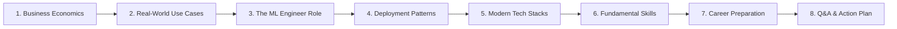

# Practical AI in Industry: Keynote Presentation & Production ML Engine

<div align="center">

[](LICENSE)
[](https://www.python.org/)
[](https://fastapi.tiangolo.com)
[](https://scikit-learn.org)
[](Dockerfile)
[-brightgreen.svg?logo=pytest&logoColor=white)](tests/)
[](#-ml-model-pipeline--feature-engineering)
[](presentation.html)

<p align="center">
  <b>A dual-purpose industry resource:</b><br>
  An executive keynote presentation deck detailing real-world AI implementation and career preparation, paired with an end-to-end, production-grade <b>Online Travel Agent (OTA) Search Ranking & Cross-Sell Recommendation Service</b>.
</p>

[Explore Slide Deck](presentation.html) • [Live Dashboard](http://localhost:8000) • [Swagger API Docs](http://localhost:8000/docs) • [Architecture](#-system-architecture)

---

</div>

> **"In coursework, the model is the finish line. In industry, a trained model is merely the starting line."**  
> *— Setia Budi, Machine Learning Engineer at tiket.com*

---

## 📑 Table of Contents

1. [Executive Summary & Vision](#-executive-summary--vision)
2. [Part I: The Presentation Deck (Theory & Industry Insights)](#-part-i-the-presentation-deck-theory--industry-insights)
   - [Speaker & Background](#speaker--background)
   - [Presentation Curriculum & Core Topics](#presentation-curriculum--core-topics)
   - [Key Industry Mental Models](#key-industry-mental-models)
   - [How to View and Deliver the Slides](#how-to-view-and-deliver-the-slides)
3. [Part II: The Production ML Engine (Implementation)](#-part-ii-the-production-ml-engine-implementation)
   - [Problem Statement & OTA Context](#problem-statement--ota-context)
   - [System Architecture](#system-architecture)
   - [ML Model Pipeline & Feature Engineering](#ml-model-pipeline--feature-engineering)
   - [Cross-Sell Collaborative Filtering Engine](#cross-sell-collaborative-filtering-engine)
   - [Interactive Dashboard & Telemetry](#interactive-dashboard--telemetry)
4. [Part III: Developer & Operations Guide](#-part-iii-developer--operations-guide)
   - [Quick Start Installation](#quick-start-installation)
   - [API Reference & Endpoints](#api-reference--endpoints)
   - [Automated Testing with PyTest](#automated-testing-with-pytest)
   - [Production Docker Deployment](#production-docker-deployment)
5. [Project Directory Layout](#-project-directory-layout)
6. [Attribution & License](#-attribution--license)

---

## 💡 Executive Summary & Vision

Most academic curricula and tutorials treat machine learning as an isolated exercise in Kaggle competitions or Jupyter Notebooks. In reality, **over 80% of a Machine Learning Engineer's day-to-day work is software and systems engineering**: data pipelines, low-latency API serving, containerization, monitoring, and business alignment.

This repository serves as a **complete bridge from theory to production**:

```text
┌────────────────────────────────────────────────────────────────────────┐
│                   PRACTICAL AI IN INDUSTRY REPOSITORY                  │
├───────────────────────────────────┬────────────────────────────────────┤
│   PART 1: THE PRESENTATION DECK   │   PART 2: THE REFERENCE SERVICE    │
│   (Mindset, Stacks & Career)      │   (Production-Grade Codebase)      │
│                                   │                                    │
│ • Real-World Industry Economics   │ • FastAPI Low-Latency Serving      │
│ • Modern MLOps & LLMOps Stacks    │ • Scikit-Learn Conversion Ranker   │
│ • Kaggle vs. Production Systems   │ • Bayesian Cross-Sell Recommender  │
│ • University-to-Career Roadmap    │ • PyTest + Docker + Web UI         │
└───────────────────────────────────┴────────────────────────────────────┘
```

---

## 🎤 Part I: The Presentation Deck (Theory & Industry Insights)

### Speaker & Background
- **Speaker:** **Setia Budi**
- **Role:** Machine Learning Engineer at **tiket.com** (one of Southeast Asia's leading Online Travel Agents).
- **Format:** [Marp](https://marp.app/) Markdown (`presentation.md`) & Standalone Interactive HTML (`presentation.html`).

### Presentation Curriculum & Core Topics

The presentation breaks down industrial AI into 8 structured modules:



1. **Why Data (and AI) Matters in Business:**
   - *Data is the new oil:* Raw data has no standalone value until it is refined through ingestion, validation, and analytics pipelines.
   - The two non-negotiable business mandates: **Reduce Operational Cost** (automation, support chatbots) and **Increase Revenue** (conversion-driven search ranking, cross-sell recommendations).
2. **What AI in Industry Actually Looks Like:**
   - De-hyping AI: The best production AI is invisible, processing millions of micro-decisions per second rather than flashing robots.
   - Practical OTA examples: Search autocomplete, hotel ranking, cross-sell recommendation, review sentiment classification, and image quality moderation.
3. **The Role of an ML / AI Engineer:**
   - Moving beyond `model.fit()`: Writing reliable, tested, and containerized software services that run 24/7 without intervention.
4. **How AI Services Are Deployed:**
   - **Synchronous (User-facing):** Real-time, ultra-low latency (< 50ms), e.g. search ranking.
   - **Asynchronous (Batch):** High throughput offline scoring (Airflow, Spark, dbt).
   - **Scheduled / Event-Driven:** Periodic retraining and feature store materialization.
5. **Modern Industry Tech Stack:**
   - *Cloud & Compute:* AWS, GCP, Azure, Kubernetes, ArgoCD.
   - *Databases & Vector Stores:* PostgreSQL, Redis, Milvus, FalkorDB.
   - *MLOps & LLMOps:* MLflow, AI Gateways, Prompt Registries.
   - *Python Toolbox:* `uv`, `FastAPI`, `Pydantic`, `PyTest`, `Polars`.
6. **Fundamental Skills that Matter:**
   - Software engineering hygiene (Clean Code, Git, Docker, System Design).
   - Growth mindset: The stack evolves every 18 months; learning agility is paramount.
   - Clear communication: Translating technical trade-offs into business KPIs.
7. **How to Prepare Before Graduation (Actionable Roadmap):**
   - Focus on building **2–3 end-to-end deployed projects** rather than ten half-finished tutorials.
   - Master SQL, the Linux command line, and Docker.
   - Put clean code on GitHub with comprehensive documentation—*your public code is your true resume*.
   - Pursue real industry internships to understand production constraints and code reviews.

### Key Industry Mental Models

| Concept | Coursework / Academic ML | Production / Industry ML |
| :--- | :--- | :--- |
| **Primary Metric** | Benchmark Accuracy / F1-Score | Business Impact (Conversion Rate, GMV, Latency, Cost) |
| **Code Deliverable** | Jupyter Notebook (`.ipynb`) | Tested, Versioned, Containerized REST/gRPC Service |
| **Data Nature** | Static, clean CSVs (Kaggle/UCI) | Noisy, drifting, streaming, real-time data pipelines |
| **Model Lifecycle** | Ends once training converges | Begins *after* the model is deployed to production |
| **Work Allocation** | ~80% Modeling & Tuning | ~80% Systems, Data Engineering, Testing & Observability |

### How to View and Deliver the Slides

The slide deck is built with [Marp](https://marp.app/) and includes custom GitHub Dark styling, typography, and presenter notes for every slide.

#### 1. Open the Pre-compiled Interactive Slides
Open `presentation.html` directly in any web browser:
```bash
# On Linux
xdg-open presentation.html

# On macOS
open presentation.html
```
- **Press `P`**: Enters **Presenter Mode** with dual-screen view, speaker notes, and real-time elapsed timer.
- **Press `F`**: Enters **Fullscreen Presentation Mode**.
- **Press `O`**: Opens **Slide Grid Overview** for rapid navigation.

#### 2. Edit or Recompile with Marp CLI
```bash
# Run local live-reload preview server
npx @marp-team/marp-cli -s .

# Export to HTML, PDF, or PowerPoint
npx @marp-team/marp-cli presentation.md -o presentation.html
npx @marp-team/marp-cli presentation.md --pdf -o presentation.pdf
npx @marp-team/marp-cli presentation.md --pptx -o presentation.pptx
```

---

## ⚙️ Part II: The Production ML Engine (Implementation)

To embody the teachings of the keynote, this repository includes a complete, enterprise-standard reference implementation of an **Online Travel Agent (OTA) Search Ranking & Cross-Sell Service**.

### Problem Statement & OTA Context
When a user searches for hotels in Bali or Jakarta with a specific budget, the platform must:
1. Filter candidate accommodations instantly.
2. Rank candidates to maximize conversion probability while matching user constraints.
3. Dynamically suggest relevant add-on activities (e.g., airport pickup, catamaran cruise, or spa) based on previous co-booking affinities.

### System Architecture

```text
[ Client / Web Browser / Mobile App ]
                    │
                    │ HTTP POST / GET (JSON)
                    ▼
┌────────────────────────────────────────────────────────────────────────┐
│                      FASTAPI ASGI APPLICATION                          │
│                                                                        │
│   ├── Latency Tracing Middleware (Injects 'X-Process-Time-Ms' header)  │
│   ├── Pydantic V2 Request & Response Validation                        │
│   │                                                                    │
│   └── Lifespan Singleton Pipeline (In-Memory Preloaded Cache)          │
│            │                                                           │
│            ├── [ Pointwise Ranking Engine ]                            │
│            │   • Model: HistGradientBoostingClassifier                 │
│            │   • Input: Query Context + Hotel Feature Vectors          │
│            │   • Output: P(Booking | Query, Hotel) score (0–100%)       │
│            │                                                           │
│            └── [ Collaborative Filtering Engine ]                      │
│                • Association Matrix: P(Addon | Hotel, City, Stars)     │
│                • Output: Ranked add-on packages with confidence scores │
└────────────────────────────────────────────────────────────────────────┘
                    │
                    ▼
      [ High-Performance Response: < 15ms Round-Trip ]
```

### ML Model Pipeline & Feature Engineering

The search ranking model is formulated as a **pointwise conversion probability estimator** using `HistGradientBoostingClassifier`.

#### Feature Engineering Vector ($X \in \mathbb{R}^{14}$):
- `price_ratio`: $\frac{\text{price\_per\_night}}{\text{user\_budget}}$ (relative price alignment).
- `price_diff_norm`: Normalized absolute price delta.
- `price_gaussian`: $\exp\left(-0.5 \times (\text{price\_ratio} - 1.0)^2\right)$ (non-linear consumer utility curve).
- `star_exact_match`: Binary indicator whether hotel stars equal preferred stars.
- `star_diff`: $|\text{hotel\_stars} - \text{pref\_stars}|$.
- `review_score` & `rating_scaled`: Calibrated user sentiment and satisfaction.
- `log_review_count`: Log-transformed popularity confidence metric ($\log(1 + \text{reviews})$).
- `distance_to_center_km` & `distance_decay`: $\exp(-\text{distance} / 10.0)$.
- `discount_percent` & `discount_factor`: Price promotion incentives.
- `value_score`: $\frac{\text{review\_score} \times 1,000,000}{\text{price\_per\_night} + 1}$ (price-to-quality ratio).

#### Evaluation Metrics:
- **ROC-AUC:** `0.7459`
- **PR-AUC (Average Precision):** `0.8088`
- **Inference Latency:** `~2.4ms` per query batch.

### Cross-Sell Collaborative Filtering Engine

The cross-sell recommender evaluates co-booking transaction patterns from over 34,000 historical session logs to calculate Bayesian-smoothed item association:

$$P(\text{Item} \mid \text{Hotel}) = \frac{C(\text{Hotel}, \text{Item}) + \alpha}{N_{\text{Bookings}}(\text{Hotel}) + \beta} + \gamma \cdot \text{Prior}_{\text{Category}}(\text{City}, \text{Stars})$$

- Suggests high-intent add-ons (Airport Shuttle, Private Dinner, Guided Diving, Balinese Spa) tailored specifically to the booked property's class and geography.
- **Inference Latency:** `< 1.0ms`.

### Interactive Dashboard & Telemetry

The application comes with a pre-configured dashboard (`static/index.html`) demonstrating production observability:
- **Live Telemetry Banner:** Real-time server latency ticker, model type, ROC-AUC score, and candidate count.
- **Dynamic Query Controls:** City selector, interactive budget slider with real-time IDR currency formatting, star class selector, and algorithmic sorting toggles (`⚡ ML Conversion AI`, `Lowest Price`, `Top Rated`).
- **Real-Time Cross-Sell Modal:** Instant add-on recommendation preview with co-booking affinity percentages upon clicking any hotel card.

---

## 🛠 Part III: Developer & Operations Guide

### Quick Start Installation

```bash
# 1. Clone the repository
git clone https://github.com/fallss/practical-ai-in-industry.git
cd practical-ai-in-industry

# 2. Create and activate a Python virtual environment
python3 -m venv .venv
source .venv/bin/activate

# 3. Install dependencies
pip install -r requirements.txt

# 4. Generate datasets and train ML models
python -m src.data.generator
python -m src.models.train_ranking
python -m src.models.recommender

# 5. Launch the FastAPI application
uvicorn src.api.app:app --host 0.0.0.0 --port 8000 --reload
```

Access the services in your browser:
- **Interactive UI:** [http://localhost:8000](http://localhost:8000)
- **Interactive Swagger Docs:** [http://localhost:8000/docs](http://localhost:8000/docs)
- **Alternative ReDoc:** [http://localhost:8000/redoc](http://localhost:8000/redoc)

---

### API Reference & Endpoints

#### 1. System Health & Diagnostics
```http
GET /api/v1/health
```
```json
{
  "status": "healthy",
  "service": "OTA Production AI & Search Ranking Engine",
  "version": "1.0.0",
  "ml_models_ready": true,
  "total_hotels_indexed": 70,
  "model_details": {
    "model_type": "HistGradientBoostingClassifier (Pointwise Conversion Ranker)",
    "metrics": {
      "roc_auc": 0.7459,
      "pr_auc": 0.8088,
      "test_samples": 6843
    }
  },
  "server_time": "2026-10-20T14:17:39.531719+00:00"
}
```

#### 2. Synchronous Search Ranking
```http
POST /api/v1/hotels/search
Content-Type: application/json
```
```json
{
  "city": "Bali",
  "user_budget": 1500000,
  "pref_stars": 4,
  "sort_by": "ml_ranking",
  "limit": 5
}
```
**Response Headers:** `X-Process-Time-Ms: 6.87`  
**Response Body:**
```json
{
  "total": 10,
  "latency_ms": 5.12,
  "sort_applied": "ml_ranking",
  "hotels": [
    {
      "hotel_id": "htl_032",
      "name": "Grand Merdeka Skyline Bali #32",
      "city": "Bali",
      "star_rating": 4,
      "price_per_night": 1240000,
      "review_score": 4.8,
      "ml_score": 92.1,
      "badges": ["Guest Favorite", "Top Recommended Match"]
    }
  ]
}
```

#### 3. Cross-Sell Recommendations
```http
GET /api/v1/recommend/cross-sell?hotel_id=htl_032&top_k=3
```
```json
{
  "hotel_id": "htl_032",
  "hotel_name": "Grand Merdeka Skyline Bali #32",
  "city": "Bali",
  "latency_ms": 0.01,
  "recommendations": [
    {
      "item_id": "act_106",
      "name": "Snorkeling Excursion to Coral Reefs",
      "category": "Adventure",
      "price": 350000,
      "confidence_percent": 39
    },
    {
      "item_id": "act_104",
      "name": "Full-Day Cultural Tour & Temple Visit",
      "category": "Tour",
      "price": 380000,
      "confidence_percent": 39
    }
  ]
}
```

---

### Automated Testing with PyTest

A solid test suite ensures production stability across feature transformations and API contracts:

```bash
pytest tests/ -v
```

```text
============================= test session starts ==============================
platform linux -- Python 3.12.3, pytest-9.1.1, pluggy-1.7.0
rootdir: /home/ifhalfaizi/Downloads/ai_ml_in_production
configfile: pytest.ini

tests/test_api.py::test_health_endpoint PASSED                           [ 14%]
tests/test_api.py::test_search_endpoint_ml_ranking PASSED                [ 28%]
tests/test_api.py::test_hotel_detail_endpoint PASSED                     [ 42%]
tests/test_api.py::test_cross_sell_endpoint PASSED                       [ 57%]
tests/test_models.py::test_data_generation PASSED                        [ 71%]
tests/test_models.py::test_feature_engineering PASSED                    [ 85%]
tests/test_models.py::test_serving_pipeline_instance PASSED              [100%]

========================= 7 passed in 3.55s =========================
```

---

### Production Docker Deployment

Deploy the entire service using containerization:

```bash
# 1. Build and run in detached mode
docker compose up --build -d

# 2. Inspect real-time logs
docker compose logs -f

# 3. Check health status
curl -i http://localhost:8000/api/v1/health

# 4. Stop service
docker compose down
```

---

## 📂 Project Directory Layout

```text
practical-ai-in-industry/
├── Dockerfile                      # Production container build
├── docker-compose.yml              # Container orchestration
├── pyproject.toml / pytest.ini      # Python configuration & test setup
├── requirements.txt                # Locked Python runtime dependencies
├── README.md                       # Comprehensive project documentation
├── presentation.html               # Interactive Marp keynote slide deck
├── presentation.md                 # Marp markdown slide source
├── data/
│   ├── hotels.json                 # 70 simulated OTA accommodations
│   └── interactions.csv            # 34,000+ session logs (impressions, clicks, bookings)
├── models/
│   ├── ranking_model.joblib        # Trained HistGradientBoosting ranker
│   └── recommender_artifacts.joblib# Cross-sell co-booking association artifacts
├── src/
│   ├── config.py                   # Centralized path & environment configuration
│   ├── data/
│   │   └── generator.py            # Synthetic Indonesian OTA data generator
│   ├── models/
│   │   ├── train_ranking.py        # Feature engineering & ranking model training
│   │   ├── recommender.py          # Bayesian co-occurrence recommender builder
│   │   └── pipeline.py             # Singleton in-memory serving pipeline
│   └── api/
│       ├── app.py                  # FastAPI initialization & latency middleware
│       ├── routes.py               # REST API route handlers
│       └── schemas.py              # Pydantic V2 request & response schemas
├── static/
│   ├── index.html                  # Responsive dark-glassmorphism dashboard
│   ├── style.css                   # Custom CSS design system
│   └── app.js                      # Client logic, live telemetry, and modal triggers
└── tests/
    ├── test_api.py                 # FastAPI integration tests
    └── test_models.py              # Feature engineering & pipeline unit tests
```

---

## 👤 Attribution & License

- **Keynote Presentation**: Authored by **Setia Budi** (Machine Learning Engineer at **tiket.com**).
- **Engineering Implementation**: Production AI architecture & codebase built for practical industry reference.
- **License**: Released under the **[GNU General Public License v3.0](LICENSE)**.
